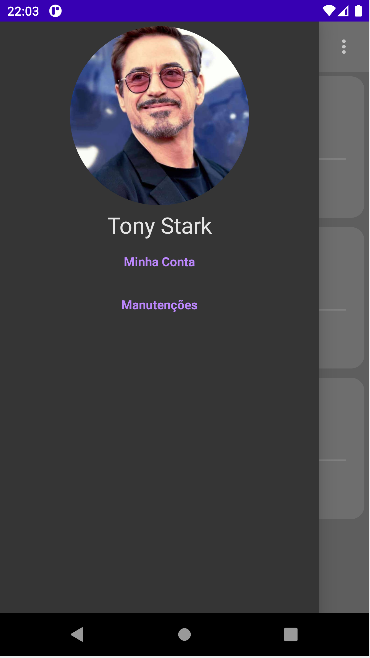
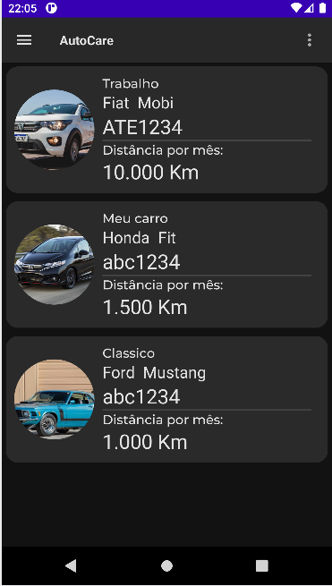
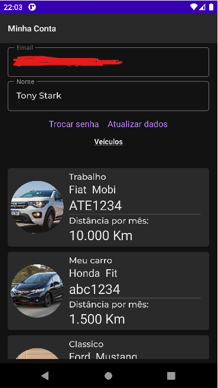
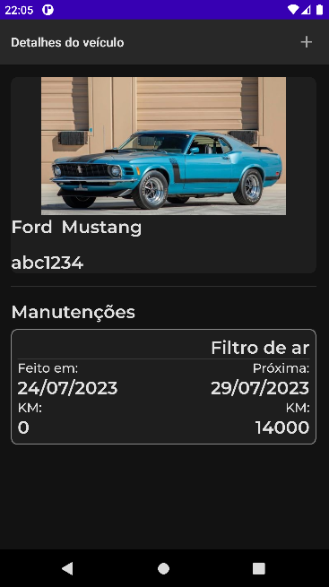
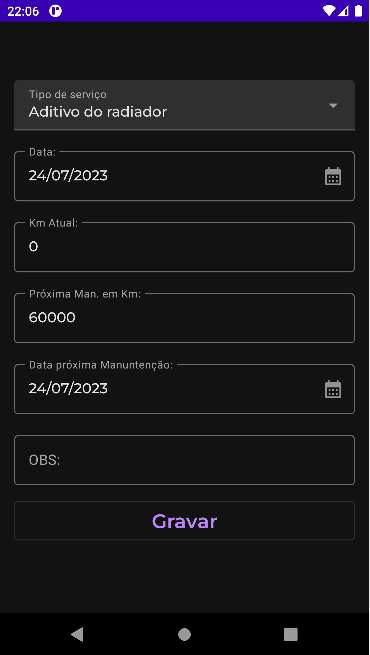

## Aplicativo AutoCare
### Uma maneira simples de fazer o controle de manutenção do seu veículo







## Como funciona

Todos os dados ficam **no aparelho**: não há conta, login nem servidor. O app abre direto, pede
um nome no primeiro acesso e funciona offline.

| O quê | Onde fica |
| --- | --- |
| Perfis, veículos e manutenções | Banco Room (`autocare.db`), esquema versionado em [`app/schemas/`](app/schemas/) |
| Fotos de perfil e de veículo | `filesDir/images/<uuid>.jpg` — o banco guarda só o caminho relativo |
| Perfil ativo | DataStore (`settings`) |
| Catálogo de tipos de serviço | [`app/src/main/assets/services.json`](app/src/main/assets/services.json), embarcado no APK |

O plano completo da migração para dados locais e da publicação na Play Store está em
[`docs/plano-publicacao.md`](docs/plano-publicacao.md).

### Fotos

Toda foto passa pelo [`ImageCompressor`](app/src/main/java/br/com/gabrielmorais/autocare/data/images/ImageCompressor.kt)
antes de ser salva — o arquivo original nunca é guardado:

| | Veículo | Perfil |
| --- | --- | --- |
| Formato | JPEG, qualidade 75 | JPEG, qualidade 75 |
| Maior lado | 1280 px | 512 px |

A recompressão aplica a orientação do EXIF e descarta os metadados da origem, inclusive a
localização GPS. Não existe "apagar foto": a foto que perde o dono (trocada, veículo ou perfil
excluído) é recolhida por [`PhotoHousekeeping`](app/src/main/java/br/com/gabrielmorais/autocare/data/images/PhotoHousekeeping.kt)
na abertura do app, com carência de 1 hora — é o que mantém o *desfazer* do snackbar funcionando.

### Catálogo de serviços

`mileageChange` é o intervalo em km e `mustBeDoneBefore` o prazo mínimo em meses. Prazo `0` é o
caso comum e significa "sem prazo por tempo": o formulário usa
`maxOf(meses pela quilometragem, mustBeDoneBefore)`. O teste
`ServicesCatalogParserTest` valida o arquivo real a cada build.

## Compilando

Nenhuma configuração externa: clone e rode.

```sh
./gradlew assembleDebug
```

O build requer **JDK 17** ou superior (AGP 8.13). O JDK embutido no Android Studio serve.

## Testes

```sh
./gradlew testDebugUnitTest          # testes JVM
./gradlew connectedDebugAndroidTest  # instrumentados: banco, compressão de imagem e telas
```

`ImageCompressor` e os DAOs do Room só têm cobertura instrumentada: `BitmapFactory`, `Bitmap` e o
SQLite são stubs no android.jar de teste e qualquer asserção passaria sem exercitar nada.

> ⚠️ `connectedDebugAndroidTest` **desinstala o app no fim**. Rode em emulador, ou num aparelho
> cujos dados do AutoCare você possa perder.

> Se o aparelho estiver pareado **sem fio** (serial no formato `adb-XXXX._adb-tls-connect._tcp`),
> versões antigas do AGP coletavam 0 testes e falhavam a task. Se acontecer, conecte por USB ou
> rode a instrumentação direto:
>
> ```sh
> ./gradlew installDebug installDebugAndroidTest
> adb shell wm dismiss-keyguard   # senão a Activity para em STOPPED
> adb shell am instrument -w \
>   br.com.gabrielmorais.autocare.test/androidx.test.runner.AndroidJUnitRunner
> ```

## CI/CD

Três workflows em [`.github/workflows/`](.github/workflows/). O setup comum — JDK 17 e cache do
Gradle — está na action composta [`.github/actions/setup-android`](.github/actions/setup-android/action.yml).

| Workflow | Dispara em | O que faz |
| --- | --- | --- |
| [`ci.yml`](.github/workflows/ci.yml) | push na `main`, todo PR | `testDebugUnitTest`, `lintDebug`, `assembleDebug` |
| [`instrumented-tests.yml`](.github/workflows/instrumented-tests.yml) | 03:00 BRT, manual | `connectedDebugAndroidTest` em emulador, API 28 e 34 |
| [`release.yml`](.github/workflows/release.yml) | tag `v*`, manual | APK + AAB assinados e GitHub Release |

### Secrets

Só o `release.yml` usa secrets — CI e testes instrumentados rodam sem nenhum, inclusive em PR de
fork. Configure em *Settings → Secrets and variables → Actions*:

| Secret | Como obter |
| --- | --- |
| `RELEASE_KEYSTORE_BASE64` | `base64 -w0 release.jks` |
| `RELEASE_KEYSTORE_PASSWORD` | senha do keystore |
| `RELEASE_KEY_ALIAS` | alias da chave |
| `RELEASE_KEY_PASSWORD` | senha da chave |

Os secrets antigos `GOOGLE_SERVICES_JSON_BASE64`, `CLOUDINARY_CLOUD_NAME`,
`CLOUDINARY_UPLOAD_PRESET` e `FIREBASE_SERVICE_ACCOUNT` não são mais lidos e podem ser apagados.

### Publicando uma versão

A tag é a fonte da versão. `versionName` sai dela e `versionCode` do número da execução:

```sh
git tag v1.1.0 && git push origin v1.1.0
```

O workflow roda testes e `lintRelease` antes de assinar — a tag pode apontar para um commit que
nunca passou no CI. Depois de assinar, confere com `apksigner verify` antes de publicar.

Para isso funcionar, [`app/build.gradle`](app/build.gradle) lê assinatura e versão de variáveis de
ambiente (`RELEASE_KEYSTORE_PATH`, `VERSION_NAME`, `VERSION_CODE`). **Sem elas o build local
continua funcionando**: versão `1`/`1.0` e `app-release-unsigned.apk`.

O `mapping.txt` do R8 vai só para os artefatos da execução (90 dias), fora da Release — é anexo
público e serve para desofuscar o APK. Sem ele, as stack traces daquela versão ficam ilegíveis
para sempre, então baixe e guarde antes de expirar (e envie junto com o AAB ao Play Console).

## Atualizando versões

Desde o Kotlin 2.0 o compilador do Compose é um plugin do próprio Kotlin e sai na mesma versão
dele. Ao subir o Kotlin, suba junto no [`build.gradle`](build.gradle) raiz:

- `kotlin_version` e os plugins `org.jetbrains.kotlin.android` e `org.jetbrains.kotlin.plugin.compose`;
- o plugin `com.google.devtools.ksp`, cujo prefixo de versão tem de ser igual ao do Kotlin;
- `room_version` e o plugin `androidx.room` andam juntos.

Combinação atual:

```
Kotlin 2.2.21 (+ plugin do compilador do Compose) / KSP 2.2.21-2.0.4  ->  compose-bom 2025.10.01
AGP 8.13.0 / Gradle 8.14.3  ->  compileSdk 36, Room 2.8.3, navigation-compose 2.9.5
```

Toda mudança de entidade do Room sobe a `version` do banco e precisa de uma `Migration` testada —
o banco é o único lugar onde os dados do usuário existem, então nada de
`fallbackToDestructiveMigration`.

> ⚠️ **Confira se o lint continua de pé depois de subir qualquer uma delas.** O lint pode
> *passar* sem estar analisando nada: já aconteceu de o analisador embutido não ler os metadados
> do Kotlin, e de as regras do `compose-runtime` serem **descartadas** por referenciar uma API
> que o lint não tinha — só sobrava um aviso `ObsoleteLintCustomCheck` no relatório.
>
> Nos dois casos `lintDebug` termina verde, mas `UnrememberedMutableState` e
> `CoroutineCreationDuringComposition` — fatais neste projeto — viram letra morta. Para checar,
> crie temporariamente um `@Composable` com `val s = mutableStateOf("x")` sem `remember`: o
> `lintDebug` **tem** que falhar. E procure `invalid APIs` / `ObsoleteLintCustomCheck` em
> `app/build/reports/lint-results-debug.txt`.
